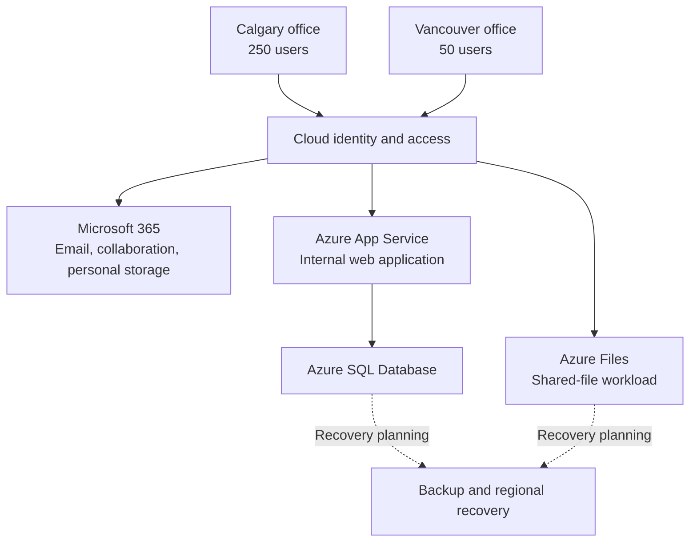
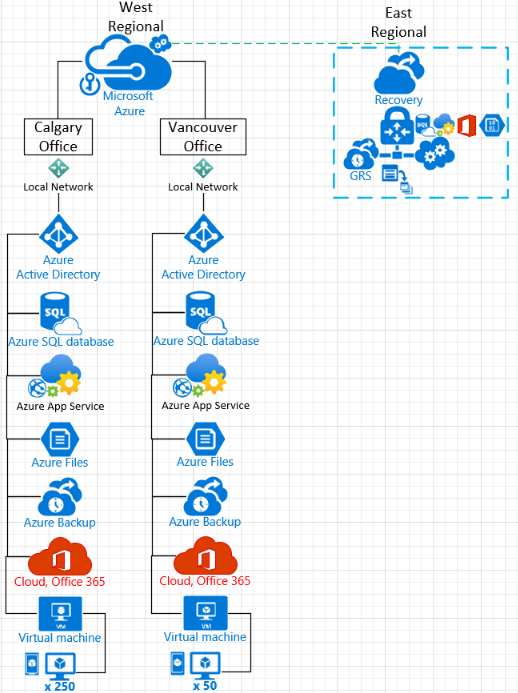

# Azure Cloud Architecture Case Study

**SAIT · Data Center Management and Virtualization (CMPS-368) · October–November 2023**

**Architecture planning · Microsoft Azure · Microsoft 365 · Identity · Business continuity · Cost analysis**

Developed a cloud-first proposal for a fictional company with 300 employees across Calgary and Vancouver. The assignment brought together business requirements, service selection, a topology diagram, recovery planning, migration phases, and a cost estimate.

This portfolio presents my academic design work and a retrospective review of the original assumptions. It is a proposal, with no verified deployment or recovery-test results.

## My work

- Mapped a two-office business scenario to cloud identity, collaboration, storage, application hosting, and database services.
- Created an Azure topology and described a phased migration and support plan.
- Defined recovery targets and considered regional redundancy, security, and data residency.
- Prepared a pricing workbook covering services and implementation work.

## Business requirements

| Requirement | Scenario |
|---|---|
| Users | 250 in Calgary and 50 in Vancouver |
| Identity | Centralized access and multifactor authentication |
| Collaboration | Email, messaging, and shared information |
| Personal storage | At least 100 GB per user |
| Applications | Internal web application and a 200 GB SQL database |
| Recovery | RPO of 12 hours; RTO of 2 hours |
| Governance | Review data location, access, and security requirements |

The recovery values are design targets. Meeting them would require tested backup and restoration procedures.

## Proposed service architecture

This new overview summarizes the service relationships in my proposal. Identity authorizes access; the arrows do not imply that identity services route application traffic. Network paths, service tiers, and recovery mechanisms still need a detailed design.

| Area | Services considered in the original proposal |
|---|---|
| Identity | Azure Active Directory and directory synchronization |
| Productivity | Microsoft 365, Exchange Online, Teams, OneDrive, SharePoint |
| Application and data | App Service, SQL Database, Azure Files, virtual machines |
| Security and operations | Key Vault, monitoring, security tooling, policy, backup |
| Connectivity and recovery | VPN or ExpressRoute; regional replication and recovery planning |

Historical service names are retained when describing the 2023 work. Service selection is not evidence of configuration or tested functionality.

## Design review and lessons

The most useful lesson is that a convincing proposal needs consistent assumptions as well as a service diagram. My retained work identifies the main business needs, but the original regional choices, storage sizing, service tiers, and quote require refinement.

The portfolio review separates the original design from issues found during review:

- Resolve the conflicting Canadian-region and US West selections before deciding where data will reside.
- Match storage capacity and service tiers to measured workload needs.
- Distinguish identity licensing from managed domain services.
- Separate recurring charges, reservations, and implementation costs in the estimate.
- Validate recovery targets through restoration exercises rather than relying on service names.

See the [design review](docs/design-review.md) and [historical estimate review](docs/cost-review.md) for the specific findings and source references.

## Detailed evidence

Original 2023 topology

The diagram records the original concept. It does not establish a deployed network, service connectivity, or working regional failover. Its West/East region labels are ambiguous; the proposal also contains conflicting region selections.

Architecture decisions and gaps

Read the [design review](docs/design-review.md) for the identity, storage, connectivity, regional, and recovery assumptions that need validation.

Pricing workbook findings

Read the [estimate review](docs/cost-review.md) for the original formula behavior, excluded VM amount, labor subtotal discrepancy, and mixed billing periods.

## Project status

Historical academic proposal with a newly written portfolio summary and review. The original source documents remain private; this selection contains the topology and concise summaries. No live Azure environment, current vendor quotation, guaranteed compliance outcome, or completed migration is claimed.
